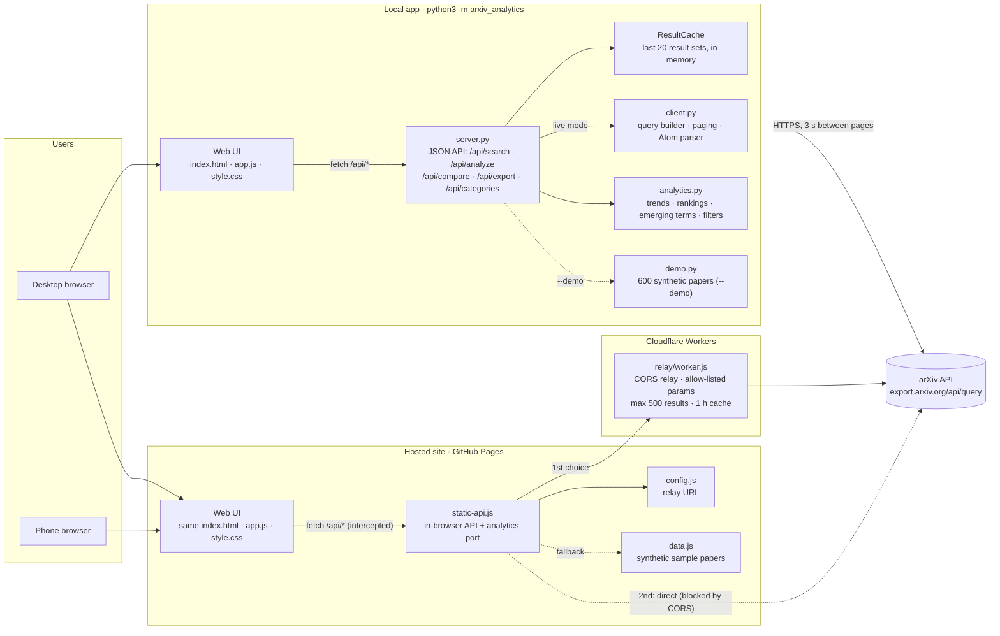
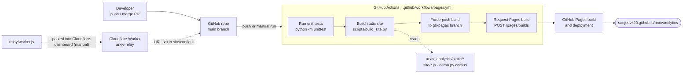

# Architecture

arXiv Research Analytics runs in two ways that share one web UI:

- **Local app** (`python3 -m arxiv_analytics`): a Python standard-library server answers the UI's
  `/api/*` calls and queries arXiv directly.
- **Hosted site** (GitHub Pages): there is no server, so `site/static-api.js` answers the same `/api/*`
  calls inside the browser and reaches arXiv through a Cloudflare Worker relay.

No paper data is stored. Results are fetched from arXiv per search, kept briefly in memory (local app)
or in the relay's one-hour cache, and analysed on the fly. The only bundled papers are synthetic samples
generated by `demo.py`.

## System

| Component | File | Role |
|---|---|---|
| Web UI | `arxiv_analytics/static/` | Search panel, filters, charts, paper list, compare. Same files in both modes. |
| API server | `arxiv_analytics/server.py` | `/api/search`, `/api/analyze` (refine a cached result), `/api/compare`, `/api/export`, `/api/categories`. |
| arXiv client | `arxiv_analytics/client.py` | Builds `search_query`, pages 200 at a time with 3 s spacing, parses the Atom feed. |
| Analytics | `arxiv_analytics/analytics.py` | KPIs, timeline, category mix and co-occurrence, top authors, keywords, emerging terms, filters. |
| Browser API | `site/static-api.js` | Port of the API and analytics for the hosted site. Order: relay, then arXiv directly, then sample data. |
| Relay | `relay/worker.js` | Cloudflare Worker that adds CORS headers arXiv lacks. Allow-listed parameters, 500-result cap, 1 h cache. |
| Sample data | `arxiv_analytics/demo.py` | 600 generated papers for `--demo` and as the hosted site's fallback (`data.js`). |

## Deployment

Every push to `main` runs the tests, builds the static site and publishes it to the `gh-pages` branch.
The workflow then asks GitHub for a Pages build, because pushes made with the workflow's own token don't
start one. The relay is deployed separately, by hand, in the Cloudflare dashboard. Its URL goes in
`site/config.js`.
